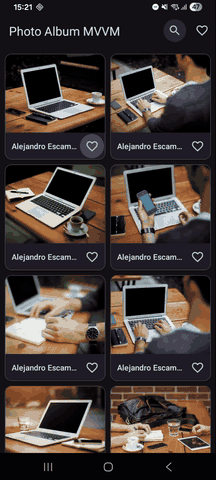

# Photo Album MVVM

A small Android app that shows the **MVVM** (Model-View-ViewModel) pattern with nothing but Jetpack and the Android platform: Kotlin, ViewModel, LiveData and Data Binding. No third-party libraries.



It loads photos from the [Picsum Photos API](https://picsum.photos) into a grid, with pagination, pull to refresh, author search, favorites (saved on device), and a detail screen.

## MVVM in this project

```
 View                      ViewModel                    Model
 (Activity + XML)   <--->  (LiveData + logic)   --->    (Repository, API, data classes)
 shows state,              holds UI state,              loads and stores data,
 forwards user input       knows nothing of Views       knows nothing of the UI
```

- **View** (`view/`): activities, layouts and the adapter. They draw whatever the ViewModel exposes and pass user actions to it. There is no business logic here.
- **ViewModel** (`viewmodel/`): holds UI state as `LiveData` and decides what to do on each action (load a page, search, toggle a favorite). It never references a `View`, `Activity` or `Context`, so it survives rotation and is easy to test.
- **Model** (`model/`, `data/`): `Photo`, `PhotoRepository`, `PicsumApi` and `FavoriteStore`. This layer fetches and persists data and knows nothing about the UI.

Data flows in one direction, and the layouts bind straight to the ViewModel:

```xml
<SwipeRefreshLayout app:refreshing="@{viewModel.isRefreshing}" ... />
<TextView app:visibleIf="@{viewModel.isEmpty}" ... />
<Button android:onClick="@{() -> viewModel.loadNextPage()}" ... />
```

```kotlin
class PhotoListViewModel(private val repository: PhotoRepository) : ViewModel() {
    val items: LiveData<List<PhotoItem>>   // View observes this
    fun search(query: String)              // View calls this
}
```

The one thing the Activity still does is wire things up: create the ViewModel, set it on the binding, and observe `items` to feed the adapter.

## Project structure

```
app/                  Application class, creates the shared repository
model/                Photo, PhotoItem
data/                 PicsumApi, FavoriteStore, PhotoRepository
viewmodel/            PhotoListViewModel, PhotoDetailViewModel, factories
view/                 PhotoListActivity, PhotoDetailActivity, PhotoAdapter, ImageLoader, BindingAdapters
```

## Build

Requires Android Studio (or JDK 17+) and Android SDK 37. Then:

```
./gradlew installDebug
```

Targets Android 7.0+ (API 24). Built with AGP 9, Gradle 9 and Kotlin.
